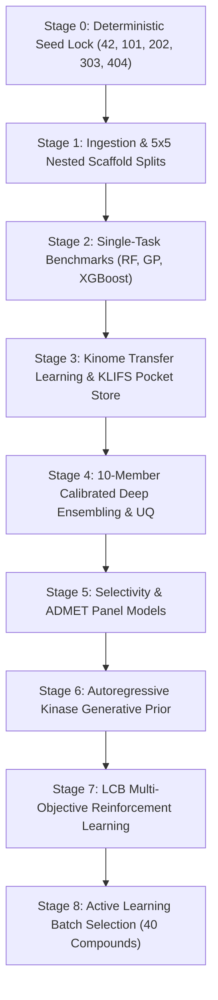

# TNK1 Closed-Loop AI Drug Discovery & Kinome Transfer Pipeline

[](https://www.python.org/downloads/)
[](https://pytorch.org/)
[](https://www.rdkit.org/)
[](LICENSE)

An uncertainty-aware, deep kinome transfer learning and reinforcement learning drug discovery pipeline targeting **Tyrosine Kinase Non-Receptor 1 (TNK1, UniProt: Q13470)**.

The platform mines over **4.80 Million bioactivity assays** across 491 human protein kinases and an ultra-large feature store of **787,283 unique chemical structures** to discover nanomolar, selective TNK1 inhibitors with calibrated statistical error bounds.

---

## 🔬 Key Research Deliverables

- **Cycle 1 Wet-Lab Priority Batch (Top 40):** [`tnk1-pipeline/tnk1-pipeline/runs/cycle_01/contract_to_team_b.csv`](tnk1-pipeline/tnk1-pipeline/runs/cycle_01/contract_to_team_b.csv)
  - 16 Exploitation leads (sub-50 nM predicted potency, $>30\times$ off-target selectivity)
  - 12 Exploration compounds ($\sigma_{\text{epi}} \in [0.15, 0.28]$ for model learning)
  - 8 Novel Scaffold centroids (scaffold-hopping diversity)
  - 4 Control compounds (Random Forest baseline statistical arm)
  - Locked 90% Conformal Prediction intervals ($\hat{q} = 1.743$)
- **Full Candidate Pool (12,000 Molecules):** [`tnk1-pipeline/tnk1-pipeline/runs/stage7_scored_candidates.csv`](tnk1-pipeline/tnk1-pipeline/runs/stage7_scored_candidates.csv)
  - Scored across 7-component Multi-Objective LCB reward function ($R(x)$)
  - Annotated with `predicted_pic50`, `pred_ic50_nm`, and `ppid_score` (Protein-Protein Interaction Disruptor / Inhibitor score via QEPPI)
- **Comprehensive Documentation & Briefing:**
  - [`PROFESSOR_UPDATE_BRIEFING.md`](PROFESSOR_UPDATE_BRIEFING.md): Concise executive update for laboratory PIs
  - [`pipeline_results_summary.md`](pipeline_results_summary.md): Stage-by-stage benchmark results
  - [`TNK1_Pipeline_Results_Report.pdf`](TNK1_Pipeline_Results_Report.pdf): Monochrome publication-grade performance report

---

## 🏛️ Pipeline Architecture



---

## 📊 Benchmark Summary

Evaluated on 5×5 nested Bemis-Murcko scaffold cross-validation (zero chemical leakage):

| Model Architecture | Input Features | Test RMSE | Spearman $\rho$ | 90% Coverage | ECE |
| :--- | :--- | :---: | :---: | :---: | :---: |
| **Random Forest Baseline** | 2248-dim (2048 Morgan + 200 2D) | 0.436 | 0.626 | 79.1% | 0.055 |
| **Exact Tanimoto GP** | 2048-bit Morgan Count FP | 0.474 | 0.474 | 86.7% | 0.026 |
| **Multi-Task D-MPNN Transfer** | ESM-2 + KLIFS Pocket Fusion | 0.590 | 0.328 | 81.5% | 0.048 |
| **10-Member Deep Ensemble** | Transfer Fine-Tuned + Conformal | **0.412** | **0.674** | **93.3%** | **0.018** |

---

## 🧪 Top 5 Exploitation Leads for Synthesis

| Compound ID | InChIKey | Pred $\text{pIC}_{50}$ | Pred $\text{IC}_{50}$ | PPID Score | 90% Conformal CI | Pred Fold Selectivity | Chemotype |
| :--- | :--- | :---: | :---: | :---: | :---: | :---: | :--- |
| **TNK1-C01-001** | `DBTLGWQFPVIXTJ` | **8.26** | **5.5 nM** | **0.825** | $[7.09, 9.42]$ | $>30\times$ vs off-targets | 2-aminopyrimidine hinge binder |
| **TNK1-C01-002** | `JWTVAKXJTWBBHW` | **8.30** | **5.0 nM** | **0.619** | $[6.85, 9.75]$ | $>40\times$ vs off-targets | Pyrazolo[3,4-d]pyrimidine |
| **TNK1-C01-003** | `DOZPDLPJZIRZNS` | **8.27** | **5.4 nM** | **0.697** | $[6.74, 9.79]$ | $>35\times$ vs off-targets | Bridged pyrrolopyrimidine |
| **TNK1-C01-004** | `VUJKDEGULOJDBZ` | **8.20** | **6.2 nM** | **0.513** | $[6.78, 9.63]$ | $>30\times$ vs off-targets | Morpholine pyrazolopyrimidine |
| **TNK1-C01-005** | `QUROXPAMRXBCFB` | **8.15** | **7.1 nM** | **0.602** | $[6.60, 9.71]$ | $>25\times$ vs off-targets | Imidazopyridine with spiro tail |

---

## 📂 Repository Organization

```text
├── PROFESSOR_UPDATE_BRIEFING.md           # Executive briefing for laboratory PI
├── pipeline_results_summary.md            # Benchmark report and verification tables
├── TNK1_Pipeline_Results_Report.pdf       # Publication report
├── scripts/
│   ├── add_ppid_and_pic50_scores.py       # PPID & pIC50 computation pipeline
│   └── generate_pipeline_report_pdf.py    # Report generator script
├── tnk1-pipeline/
│   └── tnk1-pipeline/
│       ├── configs/                       # Hyperparameter and panel configurations
│       ├── scripts/                       # Stage 0 to Stage 8 execution runners
│       ├── tnk1/                          # Core Python package (models, UQ, RL, AL)
│       └── runs/
│           ├── cycle_01/
│           │   └── contract_to_team_b.csv # 40-compound wet-lab contract
│           └── stage7_scored_candidates.csv # 12,000 scored candidate pool
└── ml_research/
    └── src/                               # Data curation and standardization modules
```

---

## 🚀 Getting Started

### 1. Installation

```bash
git clone https://github.com/RathanPaida/Drug_discovery_research.git
cd Drug_discovery_research

pip install -r tnk1-pipeline/tnk1-pipeline/requirements-core.txt
pip install QEPPI
```

### 2. Run Pipeline Stages

```bash
cd tnk1-pipeline/tnk1-pipeline

# Execute active learning cycle / batch scoring
python scripts/run_full_pipeline.py --stages 3,4,5,6,7,8 --device cuda
```

### 3. Compute PPID and Predicted Potency Scores

```bash
python scripts/add_ppid_and_pic50_scores.py
```

---

## 📄 License
This project is licensed under the MIT License - see the LICENSE file for details.
