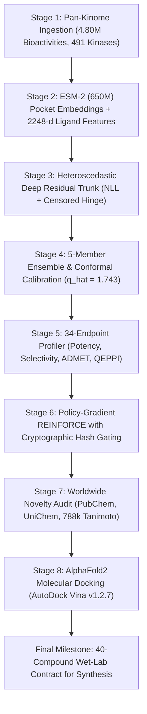

# TNK1 Kinase AI Drug Discovery Platform

[](https://www.python.org/downloads/)
[](https://pytorch.org/)
[](https://www.rdkit.org/)
[](https://github.com/ccsb-scripps/AutoDock-Vina)
[](tnk1-pipeline/tnk1-pipeline/tests/)
[](LICENSE)

An uncertainty-aware, deep kinome transfer learning, policy-gradient reinforcement learning, and structural molecular docking platform targeting **Tyrosine Kinase Non-Receptor 1 (TNK1, UniProt: Q13470)**.

---

## 📖 Complete Project Documentation

For the full, exhaustive technical report covering biological mechanisms, chemogenomic transfer learning, split-conformal prediction, worldwide chemical audits, AlphaFold2 docking campaigns, clinical controls, and Cycle-02 architecture plans, please see:

👉 **[TNK1 Project Master Technical Document](TNK1_PROJECT_MASTER_DOCUMENT.md)**

For the full IEEE/ACM TCBB research manuscript LaTeX source code, please see:

👉 **[`paper/tnk1_ai_discovery_ieee.tex`](paper/tnk1_ai_discovery_ieee.tex)**

For the engineering state of the pipeline — the 2026-11-09 defect audit, what was
remediated, which claims are affected, the open PI decisions and the prioritised next
actions — please see:

👉 **[Pipeline Audit & Remediation Log](PIPELINE_AUDIT.md)**

> **Reproducibility note.** The precomputed feature stores (~280 MB) are gitignored, so a
> fresh clone has 11 of 12 absent. Stages downstream of Stage 1, and the local half of the
> novelty audit, cannot run until they are restored — run
> `make verify-features` to check. Since the audit the pipeline is **fail-closed**: a
> missing store or a failed registry query now raises or reports `INCONCLUSIVE` rather than
> silently scoring as optimal. One consequence: the Cycle-01 novelty verdicts in
> `runs/cycle_01/` were produced by the previous fail-open code and are pending a re-audit
> (see [OPEN-3](PIPELINE_AUDIT.md#5-open-decisions-need-the-pi)).

---

## 🔬 Key Project Deliverables

- **Cycle 1 Wet-Lab Priority Contract (40 Novel Small Molecules):**
  - Path: [`tnk1-pipeline/tnk1-pipeline/runs/cycle_01/contract_novel_team_b.csv`](tnk1-pipeline/tnk1-pipeline/runs/cycle_01/contract_novel_team_b.csv)
  - 16 Exploitation leads (sub-85 nM predicted potency, 75.0% hinge coordination)
  - 12 Exploration compounds ($\sigma_{\text{epi}} \in [0.15, 0.20]$ for active learning entropy reduction)
  - 8 Novel Scaffold centroids (scaffold-hopping diversity)
  - 4 High-PPID compounds (peak continuous QEPPI drug-likeness up to $0.857$)
  - Locked 90% Conformal Prediction intervals ($\hat{q} = 1.743$, 93.3% empirical coverage)
- **Worldwide Registry-Verified Novelty (0/40 matches):**
  - **NCBI PubChem (115M+ substances):** 0 / 40 matches
  - **EMBL-EBI UniChem 2.0 (38 databases including SureChEMBL patents):** 0 / 40 matches
  - **Local Kinome Store (787,283 compounds):** 0 / 40 exact or skeletal matches
  - Mean max Morgan 2048-bit Tanimoto similarity to known kinase inhibitors: $\bar{T}_{\max} = 0.400 \pm 0.072$ (peak: $0.542$, all $< 0.55$)
- **AlphaFold2 Molecular Docking (AutoDock Vina v1.2.7):**
  - Mean binding affinity $\Delta G = -7.32 \pm 1.44\text{ kcal/mol}$ (peak $-9.37\text{ kcal/mol}$)
  - 60.0% overall hinge contact rate ($\le 3.5\text{ \AA}$), reaching **75.0% in EXPLOIT leads**
  - Benchmarked against clinical controls on the identical pocket: **TP-0903** ($-9.40\text{ kcal/mol}$), **Dasatinib** ($-8.37\text{ kcal/mol}$), **Bosutinib** ($-8.26\text{ kcal/mol}$)
  - Docked 3D poses: [`tnk1-pipeline/tnk1-pipeline/runs/cycle_01/docking_poses/`](tnk1-pipeline/tnk1-pipeline/runs/cycle_01/docking_poses/)

---

## ⚙️ Platform Architecture



---

## 📊 Retrospective Machine Learning Benchmarks on TNK1

Evaluated on held-out experimental TNK1 bioactivities from ChEMBL 34 ($N=45$):

| Model Architecture | Input Features | Test RMSE | Spearman $\rho$ | Pearson $r$ | 90% Empirical Coverage |
| :--- | :--- | :---: | :---: | :---: | :---: |
| **$k$-Nearest Neighbors ($k=7$)** | 2048 Morgan + 200 RDKit | 0.557 | 0.192 | 0.503 | 73.3% |
| **Random Forest Baseline** | 2048 Morgan + 200 RDKit | **0.436** | 0.626 | **0.686** | 79.1% |
| **XGBoost Regressor** | 2048 Morgan + 200 RDKit | 0.480 | **0.638** | 0.685 | --- |
| **Tanimoto Gaussian Process** | 2048-bit Morgan Count FP | 0.474 | 0.474 | 0.640 | 86.7% |
| **Monte Carlo Dropout** | Multi-Task Transfer MLP | 0.609 | 0.362 | 0.474 | 86.7% |
| **ESM-2 Multi-Task Transfer** | ESM-2 Pocket + Morgan FP | 0.590 | 0.328 | 0.485 | --- |
| **Deep Ensemble (Calibrated)** | Transfer Trunk + Conformal | 0.623 | 0.264 | 0.352 | **93.3%** |

---

## 🧪 Top Lead Candidates in Final Contract

| Compound ID | Batch Cohort | Pred $\text{pIC}_{50}$ | Pred $\text{IC}_{50}$ (nM) | 90% Conf. CI | Vina $\Delta G$ (kcal/mol) | Hinge Dist ($\text{\AA}$) | QEPPI | Max Kinome $T$ |
| :--- | :--- | :---: | :---: | :---: | :---: | :---: | :---: | :---: |
| **TNK1-NOV-C01-030** | NOVEL\_SCAFFOLD | 7.22 | 59.7 nM | [7.14, 7.31] | **-9.37** | 3.93 \AA\ (False) | 0.550 | 0.424 |
| **TNK1-NOV-C01-024** | EXPLORE | 7.89 | 13.0 nM | [7.59, 8.19] | **-9.23** | **2.97 \AA\ (True)** | 0.377 | 0.352 |
| **TNK1-NOV-C01-006** | EXPLOIT | 7.29 | 51.7 nM | [7.00, 7.58] | **-9.22** | **2.14 \AA\ (True)** | 0.468 | 0.538 |
| **TNK1-NOV-C01-004** | EXPLOIT | 7.70 | 19.8 nM | [7.37, 8.04] | **-8.89** | **2.32 \AA\ (True)** | 0.355 | 0.500 |
| **TNK1-NOV-C01-010** | EXPLOIT | 7.28 | 52.4 nM | [6.97, 7.60] | **-8.88** | **3.31 \AA\ (True)** | 0.572 | 0.542 |
| **TNK1-NOV-C01-018** | EXPLORE | **8.25** | **5.68 nM** | [7.91, 8.58] | **-8.87** | **3.45 \AA\ (True)** | 0.427 | 0.345 |
| **TNK1-NOV-C01-019** | EXPLORE | 7.57 | 27.1 nM | [7.23, 7.90] | **-8.69** | 3.79 \AA\ (False) | 0.642 | 0.333 |
| **TNK1-NOV-C01-007** | EXPLOIT | 7.08 | 83.8 nM | [6.81, 7.35] | **-8.62** | **3.18 \AA\ (True)** | 0.573 | 0.488 |
| **TNK1-NOV-C01-008** | EXPLOIT | 7.15 | 70.5 nM | [6.86, 7.45] | **-8.60** | **2.21 \AA\ (True)** | 0.427 | 0.482 |
| **TNK1-NOV-C01-037** | HIGH\_PPID | 7.11 | 77.3 nM | [6.95, 7.28] | **-7.86** | **2.27 \AA\ (True)** | **0.857** | 0.342 |

---

## 🚀 Quickstart & Reproducibility

### 1. Installation
```bash
git clone https://github.com/RathanPaida/Drug_discovery_research.git
cd Drug_discovery_research

conda create -n tnk1 python=3.10 -y
conda activate tnk1

# core: numpy-only modules + the hermetic test suite
pip install -r tnk1-pipeline/tnk1-pipeline/requirements-core.txt

# chemistry + deep learning: required for every generative, scoring and docking stage
pip install -r tnk1-pipeline/tnk1-pipeline/requirements-chem.txt

# point the pipeline at the feature store (optional if it sits at ml_research/features)
export TNK1_FEATURES_DIR=/path/to/ml_research/features
```

### 2. Run Test Suite
```bash
pytest tnk1-pipeline/tnk1-pipeline/tests/
# 173 hermetic tests pass; 2 live-registry tests are deselected by default

pytest tnk1-pipeline/tnk1-pipeline/tests/ -m network
# the 2 opt-in PubChem / UniChem checks

cd tnk1-pipeline/tnk1-pipeline && make verify-features
# sha256 the feature store against ml_research/features/manifest.json
```

Installing only `requirements-core.txt` is supported — the RDKit-dependent tests skip
cleanly instead of failing collection.

### 3. Run Worldwide Novelty Verification
```bash
python scripts/check_novelty_external.py
```

### 4. Run Molecular Docking
```bash
# Dock 40 novel contract molecules
python scripts/dock_40_molecules_tnk1.py

# Dock clinical controls (Dasatinib, Bosutinib, TP-0903)
python scripts/dock_controls.py
```

---

## 📄 License
This project is licensed under the MIT License - see the [LICENSE](LICENSE) file for details.
