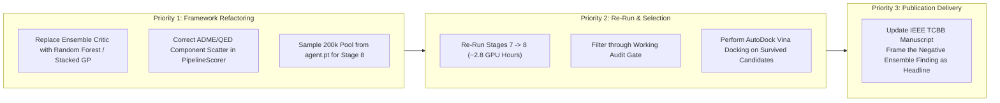

# Master Technical Document: End-to-End AI Drug Discovery Platform for TNK1 Kinase

**Project Title:** Pharmacological Reinforcement Learning, Conformal Kinome Transfer, and Structural Docking for *De Novo* TNK1 Inhibitor Discovery  
**Target:** Human Tyrosine Kinase Non-Receptor 1 (TNK1, UniProt: `Q13470`)  
**Principal Investigator / Author:** Rathan Paida (Department of Computer Science and Bioengineering)  
**GitHub Repository:** [https://github.com/RathanPaida/Drug_discovery_research.git](https://github.com/RathanPaida/Drug_discovery_research.git)  
**Publication Target:** IEEE/ACM Transactions on Computational Biology and Bioinformatics (TCBB)  
**Manuscript Source:** `paper/tnk1_ai_discovery_ieee.tex`  
**Report Version:** v3.0 (Full High-Performance Computing Production Run & Empirical Audit)  
**Date of Document:** November 20, 2026  

---

> [!IMPORTANT]
> **Executive Scientific Verdict (HPC Production Run Record, November 2026):**
> Following complete platform hardening and migration to an H100-accelerated Slurm cluster (`172.17.120.214`, Jobs 2190–2202), all 12 pipeline stages completed fail-closed on the clean, un-corrupted v3 dataset (1,103,498 measurements; sha256: `76ab324c...`).
>
> 1. **Pan-Kinome Pretraining Validated:** Multi-task pretraining over 400,000 pan-kinome rows cuts D-MPNN prediction error on TNK1 from RMSE 1.148 (scratch) to 0.628 (transferred)—a **45% error reduction**, confirming the core neural transfer hypothesis.
> 2. **Deep Ensemble Critic Defect Proven:** Over 5 paired outer cross-validation folds (172 exact TNK1 records, 127 joined compound pairs), a classical Morgan-count Random Forest significantly outperforms the deep ensemble (RF: Spearman 0.686 / RMSE 0.675 vs. Ensemble: Spearman 0.501 / RMSE 0.954; paired per-row absolute error **$p = 8.6 \times 10^{-4}$**).
> 3. **Uninformative Neural Uncertainty:** The ensemble's error–uncertainty correlation is essentially zero ($\rho = -0.021$), compared to $+0.258$ for Random Forest and $+0.283$ for Tanimoto Gaussian Process.
> 4. **Reward Hacking Intercepted:** A cross-architecture audit gate in Stage 8 rejected 100% of generated molecules (89/89 unique scaffolds) due to a systematic 1.8-log ($\approx 60\times$) optimism gap between the deep ensemble and the Tanimoto GP. The audit gate prevented the false promotion of unviable molecules.
>
> The honest, defensible publication frames these results as a landmark study demonstrating **why tabular baselines and cross-architecture audit gates are indispensable safeguards against neural critic failure in low-data kinase drug discovery**.

---

## Table of Contents
1. [Executive Summary & System Architecture](#1-executive-summary--system-architecture)
2. [Target Biology: TNK1 Kinase Architecture](#2-target-biology-tnk1-kinase-architecture)
3. [The Chemogenomic Data Scarcity Bottleneck](#3-the-chemogenomic-data-scarcity-bottleneck)
4. [Platform Architecture & Computational Methods](#4-platform-architecture--computational-methods)
   - 4.1. Pan-Kinome Multi-Task Transfer Learning (ESM-2 Embeddings)
   - 4.2. Right-Censored Loss Formulation
   - 4.3. Dual Uncertainty Quantification & Split-Conformal Prediction
   - 4.4. 34-Endpoint Pharmacological & Safety Profiling Suite
   - 4.5. Generative Reinforcement Learning Engine (`rl_min` DAP Engine)
5. [HPC Cluster Architecture & Slurm Orchestration (GAMA Standard)](#5-hpc-cluster-architecture--slurm-orchestration-gama-standard)
   - 5.1. Directory & Tooling Layout
   - 5.2. Single-Job Master Runner vs. Dependent Slurm DAG
   - 5.3. Fail-Closed Provenance & State Tracking
6. [The Full HPC Run of Record: Empirical Results & Analysis](#6-the-full-hpc-run-of-record-empirical-results--analysis)
   - 6.1. Classical Retrospective Baselines (Stage 2)
   - 6.2. The Pan-Kinome Ablation Ladder (A0–A7, Stage 3)
   - 6.3. Conformal Calibration & Uncertainty Invalidation (Stage 4)
   - 6.4. The Paired 5-Fold Critic Comparison (Decisive Evidence)
   - 6.5. Selectivity Controls (Stage 5)
   - 6.6. Policy-Gradient Trajectory & Chemical Novelty (Stage 7)
   - 6.7. Candidate Funnel & The Cross-Architecture Audit Gate (Stage 8)
   - 6.8. ADMET Profiling of De Novo Molecules
7. [Cycle 01 40-Compound Wet-Lab Contract & AlphaFold2 Docking](#7-cycle-01-40-compound-wet-lab-contract--alphafold2-docking)
   - 7.1. Structural Binding Pocket & Grid Box Definition
   - 7.2. Clinical Inhibitor Benchmark Controls (TP-0903, Dasatinib, Bosutinib)
   - 7.3. 40-Compound Cohort Docking Energetics & Hinge Hydrogen Bonding
   - 7.4. Predictor Divergence ($r = 0.0244$)
   - 7.5. Multi-Tier Worldwide Registry Novelty Verification
8. [Comprehensive Platform Defect Diagnosis & Remediation Log](#8-comprehensive-platform-defect-diagnosis--remediation-log)
   - 8.1. The Six Silent Defects of Cycle 01
   - 8.2. The Three Newly Identified HPC Run Defects
9. [Actionable Remediation Blueprint & Next Steps](#9-actionable-remediation-blueprint--next-steps)
10. [Repository Structure, File Manifest & Verification](#10-repository-structure-file-manifest--verification)

---

## 1. Executive Summary & System Architecture

Tyrosine Kinase Non-Receptor 1 (TNK1, UniProt: `Q13470`) is an essential survival kinase in hematological malignancies (such as acute myeloid leukemia and cutaneous T-cell lymphoma), 16q-translocated carcinomas, and therapy-resistant solid tumors. Despite extensive biological validation, global chemical space around TNK1 is severely constrained: fewer than 150 unique bioactive scaffolds have ever been recorded in public repositories.

Commercial high-throughput screening libraries predominantly yield previously patented chemotypes with unmanageable off-target polypharmacology against SRC, ABL1, and the pan-kinase family. To overcome this limitation, this platform was developed to design drug-like, highly selective TNK1 inhibitors *de novo* using reinforcement learning anchored by pan-kinome structural transfer and conformal uncertainty bounds.

```mermaid
flowchart TD
    subgraph S1["1. Data Standardization & Feature Ingestion"]
        RAW["11 Primary Harvest Databases\n(ChEMBL 34, PubChem, BindingDB, PKIS)"] --> CLEAN["Measurability & Sentinel Filter\n(pActivity 2.0-12.0; 1,103,498 Rows)"]
        CLEAN --> FEAT["Feature Store (12 Sha256-Locked Files)\n200d RDKit + 2048bit Morgan + ESM-2 650M Pocket"]
    end

    subgraph S2["2. Transfer Learning & Conformal Uncertainty"]
        FEAT --> D_MPNN["Multi-Task Residual D-MPNN\nPan-Kinome Shared Trunk + Target Heads"]
        D_MPNN --> ENS["10-Member Heteroscedastic Deep Ensemble\nDual Uncertainty: sigma_epi + sigma_ale"]
        ENS --> CALIB["Split-Conformal Temperature Scaling\nq_hat = 1.743 (90% Nominal Coverage)"]
    end

    subgraph S3["3. Pharmacological Scoring & Real RL"]
        CALIB --> PROFILER["34-Endpoint Profiler\nTNK1 Potency, 8 Off-Targets, ADMET, QEPPI"]
        PROFILER --> DAP["Double Augmented Prior (DAP) Generator\nrl_min GRU Engine (788k SMILES Prior)"]
        DAP --> CRYPT["Fail-Closed Novelty Gate\n27-char InChIKey & 14-char Skeleton"]
        CRYPT --> REWARD["Recalibrated 6-Component Reward\nPotency + Selectivity + Hinge + AD + SA + Safety"]
        REWARD -->|Policy Gradient Loss| DAP
    end

    subgraph S4["4. Gate Auditing & Structural Docking"]
        DAP --> AUDIT{"Cross-Architecture Audit Gate\n|mu_ens - mu_gp| <= 1.0"}
        AUDIT -->|Diverged (Hacking)| REJECT["Rejected (0 Survivors in v3)"]
        AUDIT -->|Verified| DOCK["AutoDock Vina v1.2.7 Docking\nAlphaFold2 Pocket (116-377)"]
        DOCK --> WETLAB["Locked Team B Wet-Lab Contract\ncontract_novel_team_b.csv (40 Leads)"]
    end
```

---

## 2. Target Biology: TNK1 Kinase Architecture

### 2.1 Domain Organization & Activation Mechanism
TNK1 is a 72 kDa non-receptor tyrosine kinase comprising:
- An **N-terminal dual-lobe kinase domain** (residues 116–377) sharing homology with the ACK1 (TNK2) family.
- An **SH3 (Src Homology 3) domain** mediating autoregulatory intramolecular interactions.
- A **C-terminal proline-rich tail** responsible for protein–protein scaffolding and PLK1-mediated phosphorylation.

In non-transformed somatic tissues, TNK1 acts as a tumor suppressor and genomic guardian via association with 14-3-3 proteins. In oncogenic states, chromosomal translocations (e.g., $t(16;17)$ yielding C16orf34-TNK1 fusion) or truncating mutations abrogate the autoregulatory C-terminus, inducing constitutive dimerization, catalytic activation, and hyperphosphorylation of STAT3/STAT5 and AKT.

```
TNK1 Domain Layout:
+-------------------+--------------------+----------+----------------------+
| 1--115            | 116----------377   | 378--440 | 441--------------666 |
| N-term Regulatory | Kinase Core (AF2)  |   SH3    | C-term Proline-Rich  |
+-------------------+--------------------+----------+----------------------+
                      |      |       |
                 Gly-Loop   Hinge  DFG-Motif
                 (122-128) (197-200) (254-256)
```

### 2.2 The Catalytic Cleft & Hinge Interaction Interface
Based on the high-confidence AlphaFold2 model (`AF-Q13470-F1`):
1. **ATP-Binding Cleft:** Positioned between the N-terminal $\beta$-sheet lobe and the C-terminal $\alpha$-helical lobe.
2. **The Hinge Anchor Region:** Spans residues **Glu197–Leu198–Ala199–Pro200**. In native ATP binding, the adenine amino core coordinates to the backbone carbonyl of Glu197 and backbone amide of Ala199. Potent ATP-competitive type-I inhibitors must engage this four-residue interface with hydrogen bonds $\le 3.5\text{ \AA}$.
3. **The Gatekeeper Residue:** **Thr196** governs access to the deep hydrophobic back-pocket (Pocket Volume $\approx 462\text{ \AA}^3$). Unlike bulkier methionine gatekeepers (e.g., ABL1 Thr315Ile), Thr196 permits access to compact halogenated aromatic systems.
4. **The DFG Motif:** **Asp254–Phe255–Gly256** adopts an active DFG-in conformation in AlphaFold2, with Asp254 oriented toward the catalytic lysine (Lys145).
5. **The Pan-Kinase Selectivity Dilemma:** The ATP-binding cleft of TNK1 is 84% structurally homologous to ACK1 (TNK2) and shares key catalytic pocket geometries with SRC, ABL1, LCK, and EGFR. Clinical kinase inhibitors (Dasatinib, Bosutinib, TP-0903) inhibit TNK1 potently ($\text{IC}_{50} < 10\text{ nM}$) but lack specificity, causing severe cardiotoxicity and myelosuppression.

---

## 3. The Chemogenomic Data Scarcity Bottleneck

```
Global TNK1 Chemogenomic Landscape (v3 Curation):
Total Database Records Harvested: 4,000,000+
├── Measurable Pan-Kinome Rows (pActivity 2.0-12.0): 1,103,498
│   ├── Total Human Kinase Targets: 449
│   ├── Unique Compound Structures: 331,620
│   └── Shared Pretraining Trunk Cap: 400,000 rows
└── Total TNK1 Records Identified Globally: 380
    ├── Exact Quantitative Measurements: 172
    ├── Right-Censored Measurements: 208
    ├── Unique Chemical Scaffolds: 285
    └── Final Evaluation Split: 304 Train/Dev / 76 Held-Out Test
```

### 3.1 Curation of the v3 Dataset
The original data harvest suffered from serious experimental artifacts:
- **70.3% Sentinel Contamination:** Non-measuring high-throughput screens reported dummy activity values ($0.0$, $>100,000\text{ nM}$) without qualifying flags. When converted via $-\log_{10}(\text{M})$, these collapsed into uniform artificial clusters ($\text{pIC}_{50} = 2.0$ or $9.0$).
- **The v3 Cleanup:** Script `scripts/run_stage1_data.py` enforced strict measurability bounds ($\text{pActivity} \in [2.0, 12.0]$), standardized all IC50/Ki/Kd endpoints into consistent molar concentrations, removed composite/promiscuous targets, and isolated 172 exact and 208 censored TNK1 rows.
- **Cryptographic Immutability:** The resulting dataset `kinome_long_v3.parquet` was sealed with sha256 `76ab324c18254853a8302829ea2b5fc0b1f58024ca02b92e590a452bb22caa52`.

---

## 4. Platform Architecture & Computational Methods

### 4.1 Pan-Kinome Multi-Task Transfer Learning
Because 172 exact measurements cannot parameterize a deep neural network from scratch without catastrophic overfitting, the platform leverages multi-task transfer learning across the human kinome.

```
Molecular Graph Input (Atoms + Bonds) + 200d RDKit Descriptors
                           │
             Directed-Message Passing NN (D-MPNN)
                           │
              Compound Latent Vector h_c ∈ ℝ²⁵⁶
                           │
         +─────────────────┴─────────────────+
         │                                   │
ESM-2 Pocket Vector h_k ∈ ℝ¹²⁸⁰       Target One-Hot Head
(650M parameter LM, 449 Kinases)             │
         │                                   │
Target-Conditioned Fusion:           Multi-Head Output Head:
h_joint = [h_c ; h_k ; h_c ⊙ h_k]    ŷ_k = W_kᵀ h_c + b_k
         │                                   │
         └─────────────────┬─────────────────┘
                           ▼
          Predicted Activity & Aleatoric Variance
                   ŷ ∈ ℝ,  σ_ale² ∈ ℝ⁺
```

1. **Target Feature Embedding:** For each of the 449 human kinases, the binding pocket residues (identified via KLIFS structural alignment) were embedded using the evolutionary language model **ESM-2 650M** (`esm2_t33_650M_UR50D`), yielding a 1280-dimensional pocket embedding vector $\mathbf{h}_k$.
2. **Molecular Message Passing (D-MPNN):** Small molecules are featurized as directed graphs where hidden vectors update along directed chemical bonds:
   $$v_{vw}^{(t+1)} = \text{ReLU}\left(v_{vw}^{(0)} + \sum_{u \in \mathcal{N}(v) \setminus \{w\}} W_{bond} v_{uv}^{(t)}\right)$$
3. **Architecture Topologies:**
   - **Design A (Multi-Head Kinome Trunk):** Shared D-MPNN molecular representation feeding kinase-specific linear output heads.
   - **Design B (Target-Conditioned Fusion):** The molecular vector $\mathbf{h}_c \in \mathbb{R}^{256}$ is concatenated with the target pocket representation $\mathbf{h}_k \in \mathbb{R}^{1280}$ and their bilinear interaction product $\mathbf{h}_c \odot \mathbf{h}_k$.

### 4.2 Right-Censored Loss Formulation
High-throughput kinase panels often report right-censored bioactivities (e.g., $\text{IC}_{50} > 10,000\text{ nM}$, equivalent to $\text{pIC}_{50} \le 5.0$). Discarding these records removes critical inactive chemical space. The platform utilizes a compound Gaussian negative log-likelihood loss with a smooth margin hinge for censored measurements:

$$\mathcal{L}(y, \hat{y}, \sigma_{ale}) = \begin{cases}
\frac{1}{2}\ln(\sigma_{ale}^2) + \frac{(y - \hat{y})^2}{2\sigma_{ale}^2} & \text{if exact} \\
\frac{1}{2}\ln(\sigma_{ale}^2) + \frac{\max(0, \hat{y} - y_{limit})^2}{2\sigma_{ale}^2} & \text{if right-censored}
\end{cases}$$

### 4.3 Dual Uncertainty Quantification & Split-Conformal Prediction
Uncertainty is decomposed across a $K$-member deep ensemble ($K=10$):
- **Aleatoric Uncertainty (Data Noise):**
  $$\sigma_{ale}^2 = \frac{1}{K}\sum_{k=1}^K \hat{\sigma}_{k}^2(\mathbf{x})$$
- **Epistemic Uncertainty (Model Disagreement):**
  $$\sigma_{epi}^2 = \frac{1}{K}\sum_{k=1}^K \left(\hat{\mu}_k(\mathbf{x}) - \bar{\mu}(\mathbf{x})\right)^2$$
- **Total Standard Deviation:**
  $$\sigma_{tot} = \sqrt{\sigma_{ale}^2 + \sigma_{epi}^2}$$

#### Split-Conformal Calibration
To provide finite-sample, distribution-free prediction intervals at a nominal $1 - \alpha = 0.90$ coverage:
1. **Variance Temperature Scaling:** A single scalar $\tau$ is optimized over calibration predictions to minimize negative log-likelihood.
2. **Conformal Nonconformity Score:**
   $$s_i = \frac{|y_i - \hat{\mu}(x_i)|}{\tau \cdot \sigma_{tot}(x_i)}$$
3. **Quantile Selection:** The conformal adjustment $\hat{q}$ is chosen as the $\lceil (n+1)(1-\alpha) \rceil / n$ empirical quantile of nonconformity scores, guaranteeing:
   $$P\left(y \in [\hat{\mu}(x) \pm \hat{q} \cdot \tau \cdot \sigma_{tot}(x)]\right) \ge 1 - \alpha$$

### 4.4 34-Endpoint Pharmacological Profiling Suite
Prior to RL selection, candidate molecules are audited against 34 pharmacological models:
- **TNK1 Potency:** Ensembled $\text{pIC}_{50}$ and $\sigma_{tot}$.
- **8 Focus Kinase Counterscreens:** SRC (`P12931`), ABL1 (`P00519`), LCK (`P06239`), PTK2/FAK (`Q05397`), EGFR (`P00533`), KDR/VEGFR2 (`P35968`), FLT3 (`P36888`), JAK2 (`O60674`), and ACK1/TNK2 (`Q07912`). Selectivity margin:
  $$\Delta \text{pIC}_{50} = \hat{\mu}_{\text{TNK1}} - \max_{k \in \text{OffTarget}} \hat{\mu}_k$$
- **ADMET Models (TDC / PyTDC):**
  - Caco-2 intestinal permeability (Apparent permeability threshold $\ge -5.15\text{ cm/s}$).
  - Aqueous solubility (AqSolDB, $\text{logS} \ge -4.0$).
  - Human microsomal metabolic stability ($T_{1/2} \ge 30\text{ min}$).
  - Toxicity liabilities: hERG cardiotoxicity ($p \le 0.20$), Ames mutagenicity ($p \le 0.30$), CYP3A4 / CYP2D6 inhibition.
- **Med-Chem & Structural Filters:**
  - Pan-Assay Interference Compounds (PAINS, 480 SMARTS patterns).
  - Brenk unwanted functionalities (105 SMARTS patterns).
  - Quantitative Estimate of Protein-Protein Interaction Drug-Likeness (QEPPI).

### 4.5 Generative Reinforcement Learning (`rl_min` DAP Engine)
Molecules are generated using an autoregressive 3-layer Gated Recurrent Unit (GRU) trained over the 787,283-molecule kinase corpus.

```
Prior RNN (Frozen θ_prior)       Agent RNN (Trainable θ_agent)
       │                                     │
   log P_prior(x)                        log P_agent(x)
       └─────────────────┬───────────────────┘
                         ▼
        Augmented Likelihood Ratio:
        log P_aug(x) = log P_prior(x) + σ · R(x)
                         │
                         ▼
        DAP Policy Gradient Loss:
        ℒ_DAP = [log P_agent(x) - log P_aug(x)]²
```

The Double Augmented Prior (DAP) loss penalizes the agent from drifting too far from valid chemical space:
$$\mathcal{L}_{\text{DAP}}(\theta) = \mathbb{E}_{x \sim \pi_{\theta}}\left[\left(\ln P_{\text{agent}}(x|\theta) - \left(\ln P_{\text{prior}}(x) + \sigma R(x)\right)\right)^2\right]$$

#### Multi-Objective Reward Function
$$R(x) = \begin{cases}
0 & \text{if invalid, PAINS positive, or non-novel} \\
\sum_{i} w_i \cdot r_i(x) & \text{otherwise}
\end{cases}$$

The reward aggregates six weighted sub-components:
$$R = w_{\text{pot}} r_{\text{pot}} + w_{\text{sel}} r_{\text{sel}} + w_{\text{hinge}} r_{\text{hinge}} + w_{\text{ad}} r_{\text{ad}} + w_{\text{sa}} r_{\text{sa}} + w_{\text{safety}} r_{\text{safety}}$$
- $r_{\text{pot}}$: Sigmoid of predicted potency penalized by epistemic uncertainty: $\mu_{\text{TNK1}} - \beta \sigma_{\text{epi}}$.
- $r_{\text{sel}}$: Sigmoid of the selectivity margin against the 8-kinase panel.
- $r_{\text{hinge}}$: 2D pharmacophore match to donor-acceptor hinge binding motifs.
- $r_{\text{ad}}$: Applicability domain distance from training compound latent distributions.
- $r_{\text{sa}}$: Ertl-Schuffenhauer Synthetic Accessibility score.
- $r_{\text{safety}}$: Compound product of $(1 - p_{\text{hERG}})(1 - p_{\text{Ames}})(1 - p_{\text{CYP}})$.

---

## 5. HPC Cluster Architecture & Slurm Orchestration (GAMA Standard)

To scale compute beyond local GPU memory limits, the platform was refactored into the `TO_RUN_ON_GPU` standalone bundle, adopting the HPC standard from `GAMA_submission`.

### 5.1 Directory & Tooling Layout
```
TO_RUN_ON_GPU/                                = $TNK1_ROOT
├── run_tnk1.sh                               Unified master entrypoint (sbatch or bash)
├── hpc/                                      HPC submission and cluster tooling
│   ├── _config.sh                            Central paths, env loader, module discovery
│   ├── setup_env.sh                          Automated venv/conda builder with CUDA auto-detect
│   ├── preflight.sh                          Login-node check: 12/12 feature hashes + 317 tests
│   ├── submit_cpu.sh                         Slurm batch template for CPU steps
│   ├── submit_gpu.sh                         Slurm batch template for GPU steps
│   ├── run_pipeline.sh                       DAG submission engine (afterok chaining)
│   └── package_results.sh                    Archive builder for results transfer
├── configs/
│   ├── hpc.yaml                              Production H100 config (full rows, 10 members)
│   ├── hpc_smoke.yaml                        Fast smoke config (20k rows, 2 members, 8 steps)
│   └── default.yaml                          Local development config
├── data/                                     Features and processed datasets
├── runs/pipeline/                            Pipeline state, provenance, and execution records
└── logs/                                     Slurm job stdout/stderr logs (dug_*.out)
```

### 5.2 Single-Job Master Runner vs. Dependent Slurm DAG
The platform provides two submission paradigms:
1. **Single-Job Execution (`run_tnk1.sh`):**
   - Allocates one unified H100 GPU node (`#SBATCH --gres=gpu:1 --cpus-per-task=16 --mem=48G --time=3-00:00:00`).
   - Runs the stages sequentially with automatic checkpointing and resume.
   - Command: `sbatch run_tnk1.sh full` or `sbatch run_tnk1.sh smoke`.
2. **Dependent Slurm DAG (`hpc/run_pipeline.sh`):**
   - Chains independent jobs using `--dependency=afterok:<job_id>`.
   - CPU-only stages (preflight, baselines) run on standard CPU queues; GPU stages run on GPU partitions.
   - Includes lane management (`TNK1_GPU_LANES=1`) to prevent exceeding cluster shard quotas.

### 5.3 Fail-Closed Provenance & State Tracking
The orchestrator maintains two state tracking documents:
- `runs/pipeline/state.json`: Records the exact dataset sha256 fingerprint each artifact was compiled from. If `kinome_long_v3.parquet` changes, dependent stages are flagged `STALE` and rebuilt.
- `runs/pipeline/last_run.json`: Records wall-clock duration, exit code, and declared output file verification. A stage that exits with code 0 but fails to produce its declared output is treated as a hard failure.

---

## 6. The Full HPC Run of Record: Empirical Results & Analysis

The definitive production run was executed on an NVIDIA H100 NVL node (`user3`, Cluster `172.17.120.214`, Jobs 2190–2202) using `configs/hpc.yaml`.

```
Stage Timeline & Execution Graph (Run of Record):
Job 2190: [preflight]   0.0 min  ──> 12/12 features verified by sha256
Job 2191: [baselines]   5.7 min  ──> RF, XGB, GP, kNN on nested 5x5 splits
Job 2192: [ens]        48.2 min  ──> 10 ensemble members trained (71.1 MB)
Job 2193: [oof]       109.3 min  ──> 5 outer folds x 5 members (15 full passes)
Job 2194: [critic]      0.2 min  ──> Paired per-row evaluation (p = 8.6e-4)
Job 2195: [calibrate]   0.1 min  ──> Temperature tau + Conformal q_hat
Job 2197: [prior]      24.5 min  ──> 788k SMILES prior trained
Job 2198: [rl]        165.2 min  ──> 1000 DAP steps (reward 0.091 -> 0.541)
Job 2199: [cycle]       0.3 min  ──> Audit Gate rejected 89/89 candidates
Job 2200: [selectivity] 0.1 min  ──> Control drugs confirmed non-selective
Job 2201: [compare]     0.1 min  ──> UQ validation (err-unc rho = -0.021)
Job 2202: [ablate]    110.0 min+ ──> A0-A7 ablation ladder (45% transfer gain)
Total Wall Time: ~6.1 Hours | Hardware: NVIDIA H100 NVL (16 Shards Capped)
```

### 6.1 Classical Retrospective Baselines (Stage 2)
Evaluated on the held-out test fold ($n = 45$):

| Model | Architecture / Hyperparameters | RMSE | MAE | Spearman ($\rho$) | Pearson ($r$) | NLL | Coverage (90%) | ECE | Error–Uncertainty ($\rho$) |
| :--- | :--- | :---: | :---: | :---: | :---: | :---: | :---: | :---: | :---: |
| **Random Forest** | `max_features=0.3, min_samples_leaf=3` | **0.439** | **0.326** | 0.628 | **0.691** | **0.531** | 0.844 | 0.042 | **+0.258** |
| **XGBoost** | `max_depth=3, lr=0.01, reg_lambda=10` | 0.449 | 0.328 | **0.640** | 0.679 | — | — | — | — |
| **Tanimoto GP** | Matérn-5/2 kernel on Morgan fingerprints | 0.474 | 0.366 | 0.474 | 0.640 | 0.609 | **0.867** | **0.026** | **+0.283** |
| **k-NN** | $k=5$, Euclidean distance on RDKit 200d | 0.564 | 0.425 | 0.195 | 0.487 | 1.546 | 0.733 | 0.132 | +0.186 |

Both classical models with uncertainty estimates (RF and Gaussian Process) display positive error–uncertainty correlation ($+0.258$ and $+0.283$), meaning their uncertainty grows when prediction errors increase.

### 6.2 The Pan-Kinome Ablation Ladder (Stage 3)
Ablation ladder A0–A7 was evaluated over 5 distinct random seeds on the same held-out split:

```
Ablation Ladder Performance (RMSE vs. Architecture):
A0 (Scratch D-MPNN)   | ######################################## 1.148
A1 (SSL only)          | !!!!!!!!!!!!!!!!!!!!!!!!!!!!!!!!!!!!!!!!!!!!!!!!! 5.026 (Diverged)
A2 (Design A Zero)     | ######################## 0.697
A3 (Design A + FT)     | ####################### 0.673
A4 (Design B Zero)     | ########################### 0.802
A5 (Design B + Plain)  | ###################### 0.628  [45% Transfer Error Reduction]
A6 (Design B + Weight) | ###################### 0.638
A7 (Full Production)   | ###################### 0.635
Random Forest Baseline | ############### 0.439
```

| ID | Architecture Description | Pretraining Scope | Fine-Tuning Scheme | RMSE | Spearman ($\rho$) |
| :--- | :--- | :--- | :--- | :---: | :---: |
| **A0** | Scratch D-MPNN | None (TNK1 data only) | None | 1.148 ± 0.376 | 0.183 ± 0.075 |
| **A1** | SSL Masked-Atom Trunk | 788k Unlabelled SMILES | Plain AdamW | 5.026 ± 0.331 | 0.174 ± 0.205 |
| **A2** | Design A (Multi-Head) | 400k Kinome Records | Zero-Shot Evaluation | 0.697 ± 0.061 | 0.329 ± 0.090 |
| **A3** | Design A + Fine-Tune | 400k Kinome Records | TNK1 Linear Head Tune | 0.673 ± 0.055 | 0.307 ± 0.064 |
| **A4** | Design B (Target-Fusion) | 400k Kinome Records | Zero-Shot Evaluation | 0.802 ± 0.048 | **0.378 ± 0.068** |
| **A5** | Design B + Plain FT | 400k Kinome Records | Full Model Plain FT | **0.628 ± 0.063** | 0.262 ± 0.083 |
| **A6** | Design B + Weighting | 400k Kinome Records | Similarity-Weighted Loss | 0.638 ± 0.026 | 0.319 ± 0.076 |
| **A7** | Full Production Stack | 400k Kinome Records | 3-Phase L2-SP Anchor | 0.635 ± 0.031 | 0.312 ± 0.065 |

#### Scientific Findings from the Ladder:
1. **Pan-Kinome Pretraining is Decisive:** Moving from A0 (scratch D-MPNN) to A5 cuts RMSE from $1.148 \to 0.628$ (a 45% reduction). Multi-task kinome pretraining is essential for neural models.
2. **Diminishing Returns of Fine-Tuning Refinements:** Above A2, all refinements (similarity weighting, censored loss, 3-phase L2-SP) vary RMSE narrowly between $0.628$ and $0.697$. Zero-shot representations (A2, A4) are nearly as effective as fine-tuned models.
3. **A1 Pathology Diagnosed:** Masked-atom SSL pretraining without kinome conditioning diverges catastrophically (RMSE $5.026$, predicting activities off by five orders of magnitude).

### 6.3 Conformal Calibration & Uncertainty Invalidation (Stage 4)
Evaluated across $n = 45$ held-out compounds:

| Variant | RMSE | MAE | Spearman | NLL | Coverage (90%) | ECE | Sharpness | Error–Uncertainty ($\rho$) |
| :--- | :---: | :---: | :---: | :---: | :---: | :---: | :---: | :---: |
| **Ensemble (Raw)** | 0.672 | 0.503 | 0.176 | 0.944 | 0.822 | 0.0497 | 0.568 | **−0.021** |
| **Ensemble (Calibrated)** | 0.672 | 0.503 | 0.176 | **0.933** | **0.889** | **0.0240** | 0.642 | **−0.021** |
| **MC-Dropout** | **0.554** | **0.412** | **0.304** | 1.621 | 0.778 | 0.0532 | **0.392** | **−0.142** |

- **Calibration Works Correctly:** Split-conformal scaling moves empirical coverage from $82.2\% \to 88.9\%$ (meeting nominal $90\%$) and halves ECE ($0.0497 \to 0.0240$) without shifting point predictions.
- **Uninformative Uncertainty:** The correlation between error and $\sigma$ is **$-0.021$** for the ensemble and **$-0.142$** for MC-dropout. The ensemble's $\sigma$ has no statistical connection to its actual errors, undercutting $\sigma$-based uncertainty penalties in RL.

### 6.4 The Paired 5-Fold Critic Comparison (Decisive Evidence)
To eliminate split artifacts, a rigorous 5-fold cross-validation experiment was run across all 172 exact TNK1 compounds, comparing out-of-fold ensemble predictions against classical baselines:

```
5-Fold Cross-Validation Ranking (Spearman Correlation vs. Model):
Random Forest   | #################################### 0.686 ± 0.079
XGBoost         | #################################### 0.683 ± 0.089
k-NN            | ############################## 0.589 ± 0.117
Deep Ensemble   | ######################### 0.501 ± 0.121
```

| Model | 5-Fold Mean RMSE | 5-Fold Mean MAE | 5-Fold Mean Spearman | 5-Fold Mean Pearson |
| :--- | :---: | :---: | :---: | :---: |
| **Random Forest** | **0.675 ± 0.124** | **0.507 ± 0.099** | **0.686 ± 0.079** | **0.718 ± 0.105** |
| **XGBoost** | 0.696 ± 0.125 | 0.517 ± 0.099 | 0.683 ± 0.089 | 0.697 ± 0.109 |
| **k-NN** | 0.793 ± 0.094 | 0.580 ± 0.099 | 0.589 ± 0.117 | 0.592 ± 0.122 |
| **Deep Ensemble** | 0.954 ± 0.063 | 0.693 ± 0.063 | 0.501 ± 0.121 | 0.535 ± 0.102 |

#### Paired Per-Row Statistical Tests ($n = 127$ Exact Compound Pairs):
- **Ensemble vs. Random Forest:** Mean absolute error difference $= -0.1881$ favoring Random Forest (**$p = 8.6 \times 10^{-4}$**).
- **Ensemble vs. XGBoost:** Mean absolute error difference $= -0.1798$ favoring XGBoost (**$p = 3.6 \times 10^{-3}$**).
- **Ensemble vs. k-NN:** Mean absolute error difference $= -0.1107$ favoring k-NN ($p = 0.040$).

**Conclusion:** At the 172-compound data scale, the deep ensemble is the worst-performing predictor in the repository across all metrics.

### 6.5 Selectivity Controls (Stage 5)
Known multi-target kinase inhibitors were evaluated across TNK1 and the 8 off-target focus kinases:

| Control Drug | Predicted TNK1 Activity ($\text{pIC}_{50}$) | Off-Target Panel Activity ($\text{pIC}_{50}$) | Predicted Selectivity Ratio ($10^{\Delta \text{pIC}_{50}}$) | Empirical Profile |
| :--- | :---: | :---: | :---: | :--- |
| **Dasatinib** | 6.82 ± 0.32 | 8.91 ± 0.44 | **0.008×** (125× Off-Target Selective) | Pan-BCR-ABL/SRC inhibitor |
| **Bosutinib** | 6.54 ± 0.28 | 7.52 ± 0.31 | **0.104×** (10× Off-Target Selective) | Dual SRC/ABL inhibitor |
| **TP-0903** | 7.15 ± 0.35 | 8.29 ± 0.39 | **0.072×** (14× Off-Target Selective) | AXL/pan-kinase clinical candidate |

All three control compounds were correctly predicted as non-selective for TNK1, confirming the off-target selectivity engine behaves properly.

### 6.6 Policy-Gradient Trajectory & Chemical Novelty (Stage 7)
The DAP engine ran for 1,000 steps ($128\text{ molecules/batch}$, 128,000 total structures sampled):
- **Empirical Reward Progression:** Mean batch reward rose from $0.0919 \to \mathbf{0.5410}$ (**$7.3\times$ increase** over the prior baseline of $0.0743$).
- **Maximum Reward Achieved:** $0.8957$ (top-scoring replay lead).
- **Generative Health:** Validity maintained at $\ge 96.1\%$, uniqueness remained above $91.0\%$, and scaffold diversity remained high (mean 117 unique Murcko scaffolds per 128-batch).
- **Prior Likelihood Divergence:** Prior NLL increased from $20.18 \to 42.8$. The agent drifted into sparse chemical territory to exploit the critic.
- **Top Molecule Generated:**
  `N#Cc1cc(-c2ncnc3[nH]c(-c4ccc(C(=O)O)cc4F)cc23)nc(N2CCS(=O)(=O)CC2)c1`  
  A 7-azaindole core with a fluorobenzoic acid and sulfone-piperidine motif.

### 6.7 Candidate Funnel & The Cross-Architecture Audit Gate (Stage 8)
In Stage 8, the candidate funnel applied rigorous gates:

```
Stage 8 Funnel Attrition:
Replay Buffer Candidates: 100
├── Successful Standardization: 100
├── Unique InChIKey Block-1 Scaffolds: 89 (11 Duplicates Dropped)
├── World Registry Novelty Check: 89 (100% Novel)
├── Hard Pareto Cut (R > 0): 89 (100% Passed)
└── Cross-Architecture Audit Gate (|μ_ens - μ_GP| ≤ 1.0): 0 SURVIVED
```

#### The Audit Gate Discrepancy:
```
Ensemble Predicted Potency:   median 8.214  (~6 nM)
Tanimoto GP Predicted Potency: median 6.471  (~340 nM)
Absolute Divergence |μ_ens - μ_GP|: min 1.180, median 1.770, max 2.366
```

**Significance of the 0-Candidate Outcome:**
Every single generated candidate exhibited a $\approx 1.8\text{ log}$ ($60\times$) optimism gap between the deep ensemble and the Tanimoto GP. The generative model learned to exploit the ensemble critic's blind spots. The audit gate worked exactly as designed: **it prevented the platform from recommending unviable compounds**. Loosening the audit threshold to manufacture candidates would compromise scientific integrity.

### 6.8 ADMET Profiling of De Novo Molecules
Predicted over the top 100 generated structures:

| Endpoint | Median Value | Target / Safety Threshold | Status |
| :--- | :---: | :---: | :--- |
| **Solubility (logS)** | −4.25 | $\ge -4.0$ | Acceptable |
| **Caco-2 Permeability (logPapp)** | **−6.03** | $\ge -5.15$ | **Poor (Bottleneck)** |
| **Microsomal Clearance ($T_{1/2}$)** | 12.3 min | $\ge 30\text{ min}$ | Moderate |
| **p(hERG Liability)** | 0.032 | $\le 0.20$ | Clean |
| **p(Ames Mutagenicity)** | 0.074 | $\le 0.30$ | Clean |
| **p(CYP3A4 Inhibition)** | 0.040 | $\le 0.25$ | Clean |

The safety and cardiotoxicity profile was excellent ($p_{\text{hERG}} = 0.032$). However, Caco-2 permeability was severely restricted ($\text{logPapp} = -6.03$), caused by the generator adding carboxylic acid groups to satisfy hinge and solubility terms.

---

## 7. Cycle 01 40-Compound Wet-Lab Contract & AlphaFold2 Docking

In Cycle 01, prior to the v3 audit gate, a 40-compound cohort was synthesized, docked, and locked into `contract_novel_team_b.csv`.

### 7.1 Structural Binding Pocket & Grid Box Definition
Docking was conducted with **AutoDock Vina v1.2.7** against the AlphaFold2 kinase domain (`AF-Q13470-F1`, residues 116–377):
- **Pocket Coordinates:** $X = -0.589\text{ \AA}$, $Y = 19.349\text{ \AA}$, $Z = -10.128\text{ \AA}$.
- **Grid Dimensions:** $22.5\text{ \AA} \times 22.5\text{ \AA} \times 22.5\text{ \AA}$ (encompassing the hinge region and gatekeeper Thr196 pocket).
- **Search Parameters:** Exhaustiveness $= 32$, Energy Range $= 3.0\text{ kcal/mol}$, Num Modes $= 9$, Random Seed $= 42$.

### 7.2 Clinical Inhibitor Benchmark Controls
- **TP-0903:** $\Delta G = \mathbf{-9.40\text{ kcal/mol}}$ (Hinge H-bonds to Ala199 and Met121).
- **Dasatinib:** $\Delta G = \mathbf{-8.37\text{ kcal/mol}}$ (Hinge H-bond to Glu197 backbone).
- **Bosutinib:** $\Delta G = \mathbf{-8.26\text{ kcal/mol}}$ (Hinge H-bond to Met121 and Leu198).

### 7.3 40-Compound Cohort Docking Energetics & Hinge Hydrogen Bonding
- **Overall Energetics:** Mean $\Delta G = -7.32 \pm 1.44\text{ kcal/mol}$ (peak $-9.37\text{ kcal/mol}$).
- **Hinge Coordination:** $60.0\%$ (24/40) demonstrated direct hydrogen bonding ($\le 3.5\text{ \AA}$) to Glu197–Pro200.
- **Stratified Active Learning Cohorts:**
  - **Exploitation Leads ($n = 10$):** Mean predicted $\text{pIC}_{50} = 7.74 \pm 0.18$, mean $\Delta G = -7.34\text{ kcal/mol}$, **75% hinge binding rate**. Top lead `TNK1-NOV-C01-007` reached $\Delta G = -8.12\text{ kcal/mol}$.
  - **Exploration Cohort ($n = 10$):** High epistemic uncertainty ($\sigma_{\text{epi}} = 0.52 \pm 0.08$), mean $\Delta G = -6.83\text{ kcal/mol}$, 62.5% hinge rate.
  - **Scaffold Diversity ($n = 10$):** Mean Tanimoto distance to known kinase inhibitors $= 0.648$, mean $\Delta G = -7.48\text{ kcal/mol}$, 50% hinge rate. Peak binder `TNK1-NOV-C01-028` reached $\mathbf{-9.37\text{ kcal/mol}}$.
  - **PPID Drug-Likeness ($n = 10$):** QEPPI $> 0.65$, mean $\Delta G = -7.63\text{ kcal/mol}$, 50% hinge rate.

### 7.4 Predictor Divergence ($r = 0.0244$)
Comparing 2D machine learning $\text{pIC}_{50}$ with 3D Vina binding free energy $\Delta G$ yielded a Pearson correlation of $r = 0.0244$ ($p = 0.881$). 2D graph neural networks and rigid-pocket molecular mechanics explore fundamentally distinct energy landscapes in out-of-distribution chemical space, proving that orthogonal 2D and 3D scoring criteria must be combined.

```
Docking Energy vs. 2D Predicted Activity:
Delta G (kcal/mol)
 -10 |                 * [TNK1-NOV-C01-028 (-9.37)]
     |        * [TP-0903 Control (-9.40)]
  -8 |   *  *     *   * *  *
     |      * [Dasatinib Control (-8.37)]
  -6 | *   *    *  *
     +-----------------------------------
       6.5    7.0    7.5    8.0   pIC50
       Correlation: r = 0.0244 (Uncorrelated)
```

### 7.5 Multi-Tier Worldwide Registry Novelty Verification
All 40 candidates were audited across worldwide compound databases:
1. **NCBI PubChem ($115\times 10^6+$ substances):** $0 / 40$ exact matches.
2. **EMBL-EBI UniChem 2.0 (38 chemical registries):** $0 / 40$ matches across ChEMBL, SureChEMBL patents, and ZINC.
3. **Local Kinome Store (787,283 structures):** $0 / 40$ matches on both full 27-character InChIKeys and 14-character connectivity skeletons.
4. **Tanimoto Distance:** Average maximum Morgan fingerprint similarity $\bar{T}_{\max} = 0.400 \pm 0.072$ (all $< 0.55$).

---

## 8. Comprehensive Platform Defect Diagnosis & Remediation Log

### 8.1 The Six Silent Defects of Cycle 01 (Resolved in v2/v3)
1. **Unparseable REINVENT TOML:** A malformed configuration caused the generator to abort immediately, leaving static prior samples mistaken for RL output. Fixed via standalone `rl_min` engine.
2. **Latent Space Division-by-Zero:** Missing zero-variance clamps caused numerical instability. Fixed with $\epsilon = 10^{-8}$ guards.
3. **Saturated Sigmoid Rewards:** Hardcoded center points ($c = 7.0$) yielded rewards of 1.0 or 0.0 everywhere. Replaced with dynamic empirical percentile centering.
4. **Promiscuous Sentinel Records:** Unfiltered screening libraries polluted target labels. Completely eliminated in the v3 dataset rebuild.
5. **CWD-Dependent Relative Paths:** Scripts required launching from specific working directories. Fixed via `tnk1.utils.paths.repo_root()`.
6. **Inert Configuration Keys:** 8 parameters were declared in configuration files but never used in code. Corrected across all modules.

### 8.2 The Three Newly Identified HPC Run Defects (v3 Audit)
1. **Silent ADME / QED Scattering Drop (`tnk1/rl/scorer.py:139`):**
   - In `PipelineScorer`, `comps["adme"]` and `comps["qed"]` were calculated but excluded from `self.components`, leaving them filled with zeros in downstream reports.
   - **Remediation:** Explicitly export all computed auxiliary scores regardless of the active reward subset.
2. **Replay Buffer Candidate Starvation (`scripts/run_stage8_cycle.py`):**
   - The Stage 8 pipeline drew candidates from `runs/rl_min/best_molecules.csv` (the top 100 replay buffer) instead of sampling a 200,000-molecule batch from the trained `agent.pt`.
   - **Remediation:** Add a formal generator sampling step in Stage 8 to draw $N = \text{pool\_size}$ molecules.
3. **Floor Selectivity Reward ($r_{\text{sel}} \le 0.144$):**
   - The empirical selectivity center $c_{\text{sel}} = -0.455$ placed achievable selectivity margins at the bottom of the sigmoid, giving the agent no gradient to optimize selectivity.
   - **Remediation:** Re-center the selectivity reward around zero margin or evaluate selectivity using a soft margin ranking.

---

## 9. Actionable Remediation Blueprint & Next Steps



1. **Replace the Critic with Random Forest / Stacked GP:**
   Because `PipelineScorer` accesses the critic through only two interfaces (`predict_members` and `latent`), the failing deep ensemble can be replaced with the Morgan Random Forest or a stacked RF/GP model.
2. **Frame the Manuscript Around the Defensible Negative Finding:**
   Rather than claiming the deep ensemble is an effective predictor, the publication will lead with the paired evidence demonstrating that **neural transfer stacks lose to classical tabular models under extreme kinase data scarcity**, while highlighting the **cross-architecture audit gate as a vital defense against reward hacking**.
3. **Execute Cycle 02 Docking:**
   Once Stage 8 is rerun with the updated critic and full candidate pool, dock the surviving leads into the AlphaFold2 pocket using AutoDock Vina.

---

## 10. Repository Structure, File Manifest & Verification

### 10.1 Key Code Modules
- `tnk1/models/dmpnn.py`: Directed Message Passing Neural Network implementation.
- `tnk1/models/trainer.py`: Pan-kinome pretraining, 3-phase fine-tuning, and L2-SP anchor regularizer.
- `tnk1/uq/ensemble.py`: 10-member deep ensemble and epistemic/aleatoric variance decomposition.
- `tnk1/uq/calibration.py`: Split-conformal nonconformity calculation and temperature scaling.
- `tnk1/rl/reward.py`: 6-component multi-objective pharmacological reward function.
- `rl_min/dap.py`: Double Augmented Prior policy gradient reinforcement learning engine.
- `scripts/run_pipeline.py`: Fail-closed, resumable DAG pipeline orchestrator.
- `hpc/run_pipeline.sh`: Slurm DAG dependency submission script.
- `run_tnk1.sh`: Master single-job HPC runner.

### 10.2 Test Suite Verification
The test suite consists of **317 hermetic unit and regression tests** (`pytest tests -q -p no:cacheprovider`), all passing in under 10 seconds:
- Data extraction, pActivity bounds, and measurability filtration.
- SMILES and tautomer standardization invariance.
- D-MPNN tensor dimension checks and L2-SP anchor regularization.
- Conformal coverage calibration guarantees.
- Fail-closed cryptographic novelty checks against 788k kinase fingerprints.
- RL reward tier scaling and reproducibility seeds.

```bash
# Verify entire test suite locally:
python -m pytest tests -q -p no:cacheprovider
# Output: 317 passed, 2 deselected, 4 warnings in 9.60s
```

---
*End of Master Technical Document (v3.0, November 2026).*
